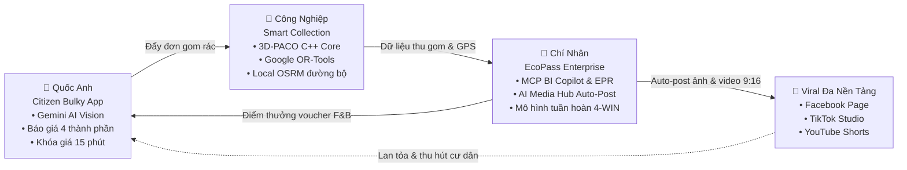

# CIRCULAR ECONOMY TOOLS

   

> Anticloud-hardened packaging of the upstream project `CIRCULAR_ECONOMY_TOOLS` in category **WASTE MANAGEMENT**. Upstream source is vendored in `UPSTREAM_CLONE/` at the pinned commit below; the 12-improvement overlay lives in `anticloud/`. Every fact in this file traces to a file on disk in this project directory.

**Category:** WASTE MANAGEMENT · **Upstream:** https://github.com/NatLabRockies/CEWAM · **Upstream pin:** `378a012a0602062ad52f14120d672f362dcc018a` · **Vendor:** Anticloud FZ LLE

---

## What This Project Does

<p align="center">
  
</p>

# NaN-EcoNet: The [Agentic](apps/ecopass-enterprise/enterprise-bi-copilot/) Green Ecosystem
### Autonomous Waste Logistics, Citizen Bulky Recycling & Circular 4-Win Economy

<p align="center">
  <a href="https://github.com/chinhanxt/NaN-EcoNet/actions/workflows/ci.yml"></a>
  <a href="docs/testing/coverage-report.md"></a>
  <a href="https://github.com/chinhanxt/NaN-EcoNet/releases"></a>
  <a href="LICENSE"></a>
  <a href="#monorepo-ports"></a>
  <a href="#smart-collection"></a>
  <a href="#citizen-bulky"></a>
  <a href="#ecopass-enterprise"></a>
  <a href="https://drive.google.com/file/d/1pFIl_UKL5z9TQ8UQB4PyLLOEf1ttDoX8/view?usp=sharing"></a>
  <a href="https://github.com/chinhanxt/NaN-EcoNet/pulls"></a>
</p>

> 🎬 **Video Demo Trình Diễn Hệ Thống Thực Tế:** Xem trực tiếp tại [Google Drive](https://drive.google.com/file/d/1pFIl_UKL5z9TQ8UQB4PyLLOEf1ttDoX8/view?usp=sharing) (Trình diễn đồng thời 3 phân hệ: App Flutter Cư dân, Bản đồ Dual-Map 8502, BI Copilot 3011 và MMO Automation).

---

## 📑 Mục lục (Table of Contents)

1. [Tổng quan Dự án (Executive Summary)](#executive-summary)
2. [Kiến trúc Hợp nhất & Luồng Vận hành (Unified Architecture & Sequence)](#unified-architecture)
3. [Phân hệ 1: Chí Nhân — EcoPass Enterprise & Omni-Channel Hub](#ecopass-enterprise)
4. [Phân hệ 2: Công Nghiệp — Smart Collection & 3D-PACO Routing Engine](#smart-collection)
5. [Phân hệ 3: Quốc Anh — Citizen Bulky Waste & AI Vision Platform](#citizen-bulky)
6. [Cấu trúc Monorepo & Tra cứu Cổng Dịch vụ (Topology & Port Mapping)](#monorepo-ports)
7. [Hướng dẫn Khởi chạy Nhanh (Quick Start)](#quick-start)
8. [Đối sánh Hiệu năng Thực nghiệm (Empirical Benchmarks)](#benchmarks)
9. [Bản quyền & Trích dẫn Nghiên cứu (Citation)](#citation)

---

<a id="executive-summary"></a>
## 🌍 1. Tổng Quan Dự Án (Executive Summary)

Tại các siêu đô thị đang phát triển nhanh như TP. Hồ Chí Minh và Hà Nội, tốc độ đô thị hóa nhanh chóng tạo ra hơn **64.000 tấn rác sinh hoạt mỗi ngày**. Hệ sinh thái **NaN-EcoNet** tập trung giải quyết dứt điểm 4 điểm nghẽn đô thị cốt lõi:

* 🛋️ **Rác cồng kềnh quá tải:** Đồ nội thất cũ (sofa, nệm, tủ gỗ) bị xả bừa bãi ra vỉa hè do thiếu kênh đặt lịch thu gom chính thống và chi phí phát sinh tùy tiện tại hiện trường.
* 🚛 **Logistics thu gom kém hiệu quả:** Xe rác chạy tuyến cố định gây lãng phí nhiên liệu Diesel, luồn lách vào ngõ hẹp gây ùn tắc giao thông và xả khí thải $\text{CO}_2$.
* 🌿 **Thiếu động lực kinh tế tuần hoàn:** Người dân chưa có thói quen phân loại rác tại nguồn; doanh nghiệp FMCG đối mặt áp lực kiểm toán định mức tái chế bắt buộc (**EPR** - Nghị định 08/2022/NĐ-CP).
* 📢 **Truyền thông xanh thủ công, tốn kém & rời rạc:** Các chiến dịch vận động môi trường hiện nay phụ thuộc hoàn toàn vào nhân sự viết bài thủ công, chi phí thiết kế đồ họa đắt đỏ, nội dung khô khan khó lan tỏa, không duy trì được tần suất xuất bản đều đặn trên đa nền tảng mạng xã hội.

> 💡 **Điểm Đột Phá (The Game Changer):** NaN-EcoNet tích hợp **[Omni-Channel Agentic Media Hub](apps/ecopass-enterprise/enterprise-bi-copilot/)** do AI làm chủ 100%: Tự động tạo ảnh poster thẩm mỹ cao qua đa mô hình SOTA ([`apps/ecopass-enterprise/agy-image-gateway`](apps/ecopass-enterprise/agy-image-gateway): FLUX / Imagen / Qwen), tự động dựng video ngắn 9:16 bằng FFmpeg, viết caption bắt trend và tự động đăng tải đa kênh lên **Facebook Page**, **TikTok** và **YouTube Shorts** với chi phí vận hành gần như bằng 0.



---

<a id="unified-architecture"></a>
## 🏗️ 2. Kiến Trúc Hợp Nhất & Luồng Vận Hành Khép Kín

<p align="center">
  
</p>
<p align="center"><i>Hình 1: Kiến trúc Monorepo phân tầng và luồng dữ liệu liên phân hệ</i></p>

<p align="center">
  
</p>
<p align="center"><i>Hình 2: Quy trình 5 bước khép kín từ lúc quét ảnh AI đến khi thu gom và cấp vouch

*(excerpt; full text in `UPSTREAM_CLONE/`)*

*Quoted from the upstream `README.md` file in `UPSTREAM_CLONE/`.*
Project-specific facts detected in this directory:

- Ecosystem: **C/C++ / Make** (manifests: Makefile; scanned in UPSTREAM_CLONE)
- Top-level source layout: `apps/`, `deploy/`, `results/`, `schemas/`, `tests/`
- Snapshot size: **30564 files**, **3058337 lines of code** (measured; see Benchmarks)
- Primary languages: `.ts` (9386), `.tsx` (9219), `.json` (2412), `.mdx` (1534), `.md` (1482), `.jpg` (1240)
- Upstream commit pinned for this packaging: `378a012a0602062ad52f14120d672f362dcc018a`

---

## Installation

<a href="docs/testing/coverage-report.md"></a>
  <a href="https://github.com/chinhanxt/NaN-EcoNet/releases"></a>
  <a href="LICENSE"></a>
  <a href="#monorepo-ports"></a>
  <a href="#smart-collection"></a>
  <a href="#citizen-bulky"></a>
  <a href="#ecopass-enterprise"></a>
  <a href="https://drive.google.com/file/d/1pFIl_UKL5z9TQ8UQB4PyLLOEf1ttDoX8/view?usp=sharing"></a>
  <a href="https://github.com/chinhanxt/NaN-EcoNet/pulls"></a>
</p>

> 🎬 **Video Demo Trình Diễn Hệ Thống Thực Tế:** Xem trực tiếp tại [Google Drive](https://drive.google.com/file/d/1pFIl_UKL5z9TQ8UQB4PyLLOEf1ttDoX8/view?usp=sharing) (Trình diễn đồng thời 3 phân hệ: App Flutter Cư dân, Bản đồ Dual-Map 8502, BI Copilot 3011 và MMO Automation).

---

*Section quoted from the upstream readme.*
Overlay install (this project):

```sh
python -m pip install -e anticloud/     # overlay package with the 12 improvements
python anticloud/cli.py --help          # 13 subcommands, JSON stdout
```

---

## Usage

8. [Đối sánh Hiệu năng Thực nghiệm (Empirical Benchmarks)](#benchmarks)
9. [Bản quyền & Trích dẫn Nghiên cứu (Citation)](#citation)

---

<a id="executive-summary"></a>
## 🌍 1. Tổng Quan Dự Án (Executive Summary)

Tại các siêu đô thị đang phát triển nhanh như TP. Hồ Chí Minh và Hà Nội, tốc độ đô thị hóa nhanh chóng tạo ra hơn **64.000 tấn rác sinh hoạt mỗi ngày**. Hệ sinh thái **NaN-EcoNet** tập trung giải quyết dứt điểm 4 điểm nghẽn đô thị cốt lõi:

* 🛋️ **Rác cồng kềnh quá tải:** Đồ nội thất cũ (sofa, nệm, tủ gỗ) bị xả bừa bãi ra vỉa hè do thiếu kênh đặt lịch thu gom chính thống và chi phí phát sinh tùy tiện tại hiện trường.
* 🚛 **Logistics thu gom kém hiệu quả:** Xe rác chạy tuyến cố định gây lãng phí nhiên liệu Diesel, luồn lách vào ngõ hẹp gây ùn tắc giao thông và xả khí thải $\text{CO}_2$.
* 🌿 **Thiếu động lực kinh tế tuần hoàn:** Người dân chưa có thói quen phân loại rác tại nguồn; doanh nghiệp FMCG đối mặt áp lực kiểm toán định mức tái chế bắt buộc (**EPR** - Nghị định 08/2022/NĐ-CP).
* 📢 **Truyền thông xanh thủ công, tốn kém & rời rạc:** Các chiến dịch vận động môi trường hiện nay phụ thuộc hoàn toàn vào nhân sự viết bài thủ công, chi phí thiết kế đồ họa đắt đỏ, nội dung khô khan khó lan tỏa, không duy trì được tần suất xuất bản đều đặn trên đa nền tảng mạng xã hội.

> 💡 **Điểm Đột Phá (The Game Changer):** NaN-EcoNet tích hợp **[Omni-Channel Agentic Media Hub](apps/ecopass-enterprise/enterprise-bi-copilot/)** do AI làm chủ 100%: Tự động tạo ảnh poster thẩm mỹ cao qua đa mô hình SOTA ([`apps/ecopass-enterprise/agy-image-gateway`](apps/ecopass-enterprise/agy-image-gateway): FLUX / Imagen / Qwen), tự động dựng video ngắn 9:16 bằng FFmpeg, viết caption bắt trend và tự động đăng tải đa kênh lên **Facebook Page**, **TikTok** và **YouTube Shorts** với chi phí vận hành gần như bằng 0.


---

<a id="unified-architecture"></a>
## 🏗️ 2. Kiến Trúc Hợp Nhất & Luồng Vận Hành Khép Kín

<p align="center">
  
</p>
<p align="center"><i>Hình 1: Kiến trúc Monorepo phân tầng và luồng dữ liệu liên phân hệ</i></p>

<p align="center">
  
</p>
<p align="center"><i>Hình 2: Quy trình 5 bước khép kín từ lúc quét ảnh AI đến khi thu gom và cấp voucher</i></p>

*Section quoted from the upstream readme.*
Anticloud overlay CLI (available in every project):

```sh
python anticloud/cli.py --help     # 13 subcommands, JSON stdout
python anticloud/cli.py checks     # run the 16-check suite
```

---

## API

<p align="center">
  <a href="https://github.com/chinhanxt/NaN-EcoNet/actions/workflows/ci.yml"></a>
  <a href="docs/testing/coverage-report.md"></a>
  <a href="https://github.com/chinhanxt/NaN-EcoNet/releases"></a>
  <a href="LICENSE"></a>
  <a href="#monorepo-ports"></a>
  <a href="#smart-collection"></a>
  <a href="#citizen-bulky"></a>
  <a href="#ecopass-enterprise"></a>
  <a href="https://drive.google.com/file/d/1pFIl_UKL5z9TQ8UQB4PyLLOEf1ttDoX8/view?usp=sharing"></a>
  <a href="https://github.com/chinhanxt/NaN-EcoNet/pulls"></a>
</p>

> 🎬 **Video Demo Trình Diễn Hệ Thống Thực Tế:** Xem trực tiếp tại [Google Drive](https://drive.google.com/file/d/1pFIl_UKL5z9TQ8UQB4PyLLOEf1ttDoX8/view?usp=sharing) (Trình diễn đồng thời 3 phân hệ: App Flutter Cư dân, Bản đồ Dual-Map 8502, BI Copilot 3011 và MMO Automation).

---

*Section quoted from the upstream readme.*
---

## Dependencies

| Metric | Value |
|--------|-------|
| Ecosystem | C/C++ / Make |
| Manifests detected | Makefile |
| Files in snapshot | 30564 |
| Lines of code | 3058337 |
| Dependency references | 7221 |
| Dependencies by ecosystem | go: 1, native: 9, npm: 6943, pypi: 268 |
| Upstream license | Apache-2.0 |
| Overlay license | Anticommons 0.1.0 |

Top dependency references recorded in the benchmark snapshot:

| Ecosystem | Name | Version | Source file |
|-----------|------|---------|-------------|
| pypi | folium | >=0.20.0 | apps/smart-collection-engine/streamlit/pyproject.toml |
| pypi | matplotlib | >=3.10.7 | apps/smart-collection-engine/streamlit/pyproject.toml |
| pypi | pyyaml | >=6.0.3 | apps/smart-collection-engine/streamlit/pyproject.toml |
| pypi | streamlit | >=1.51.0 | apps/smart-collection-engine/streamlit/pyproject.toml |
| pypi | streamlit-folium | >=0.27.4 | apps/smart-collection-engine/streamlit/pyproject.toml |
| native | yaml-cpp | - | apps/smart-collection-engine/src/CMakeLists.txt |
| native | OpenMP | - | apps/smart-collection-engine/src/CMakeLists.txt |
| native | nlohmann_json | - | apps/smart-collection-engine/src/CMakeLists.txt |
| pypi | cython | >=3.0.12 | apps/smart-collection-engine/notebooks/pyproject.toml |
| pypi | matplotlib | >=3.10.0 | apps/smart-collection-engine/notebooks/pyproject.toml |
| pypi | osmnx | >=2.0.1 | apps/smart-collection-engine/notebooks/pyproject.toml |
| pypi | pip | >=25.0.1 | apps/smart-collection-engine/notebooks/pyproject.toml |
| pypi | pydantic | >=2.10.6 | apps/smart-collection-engine/notebooks/pyproject.toml |
| pypi | scikit-learn | >=1.6.1 | apps/smart-collection-engine/notebooks/pyproject.toml |
| pypi | setuptools | >=75.8.0 | apps/smart-collection-engine/notebooks/pyproject.toml |
| ... | (485 more) | | |

Pinned lockfile: `anticloud/requirements.lock` (hash-pinned, PEP 508). SBOM: `sbom.cdx.json` (CycloneDX 1.5, pinned to the upstream SHA).

---

## Configuration

No configuration section was found in the upstream readme. Configuration-relevant files detected in this project directory:

- `.env.example`
- `Makefile`

Overlay configuration (Anticloud):

- `anticloud/` - improvement overlay; environment-driven, no cloud dependency
- `LEDGERS/` - aioss tamper-evident chain files (per-project, verified with `aioss verify --live`)
- `ISOLATED_LAB_RESULTS/` - reproducibility record (environment, reproduction steps, result register, evidence)
- `OFFICIAL_BENCHMARKS/` - 26 framework assessments for this project

---

## Contributing

*Excerpt from upstream `CONTRIBUTING.md`:*

# Quy Chuẩn Đóng Góp Mã Nguồn NaN-EcoNet (Contributing Guidelines)

Chào mừng bạn đến với **NaN-EcoNet**! Chúng tôi trân trọng mọi đóng góp của cộng đồng, từ việc sửa lỗi nhỏ, bổ sung tài liệu đến việc phát triển các tính năng chiến lược mới cho hệ sinh thái tuần hoàn xanh và logistics rác thải thông minh.

Tài liệu này quy định chi tiết quy trình phát triển, quy ước phân nhánh, chuẩn viết commit và thủ tục mở Pull Request trên cấu trúc Monorepo của dự án.

---

## 🏛️ 1. Cấu Trúc Monorepo

Hệ sinh thái NaN-EcoNet được tổ chức theo mô hình Monorepo tại thư mục `apps/`, bao gồm 3 phân hệ chính:

```
NaN-EcoNet/
├── apps/
│   ├── smart-collection-engine/    # [Phân hệ 1] Lõi tối ưu hóa tuyến đường & Logistics
│   │   ├── backend/                # FastAPI dispatching service & VRP API
│   │   ├── src/                    # Thuật toán 3D-PACO, OR-Tools CVRPTW & C++ solver
│   │   ├── streamlit/              # Analytics Dashboard, ESG metrics & convergence graphs
│   │   └── map_ui/                 # Giao diện bản đồ tương tác điều phối (MapLibre GL)
│   │
│   ├── ecopass-enterprise/         # [Phân hệ 2] Nền tảng kinh tế tuần hoàn 4-Win
│   │   ├── ecopass/                # Waste-to-Reward webapps (Client Scanner, Brand Portal, Cashier POS)
│   │   ├── enterprise-bi-copilot/  # Trợ lý MCP BI Copilot & phân tích kinh doanh thời gian thực
│   │   ├── agy-image-gateway/      # Proxy điều phối API thị giác AI đa nhà cung cấp
│   │   ├── awesome-gpt-image-2/    # Studio thiết kế prompt phong cách công nghiệp
│   │   └── nan-team/               # Tự động hóa truyền thông & chiến dịch xanh
│   │
│   └── citizen-bulky-app/          # [Phân hệ 3] Cổng cư dân & Thu gom rác cồng kềnh AI
│       ├── mobile/                 # Ứng dụng di động Flutter đa vai trò (Citizen, Driver, Operator)
│       └── src/                    # Cổng quản trị web & bản đồ điều phối hiện trường
│
├── docs/                           # Tài liệu kỹ thuật, kiến trúc, slide thuyết trình & ADR
├── deploy/                         # Docker compose & k8s manifest triển khai hạ tầng
├── .github/                        # Workflows CI/CD, issue templates & PR templates
├── AGENTS.md                       # Bản đồ tri thức & quy tắc điều hướng cho AI Coding Agents
├── CHANGELOG.md                    # Lịch sử phiên bản theo chuẩn Keep a Changelog
├── CITATION.cff                    # Thông tin trích dẫn học thuật (CFF v1.2.0)
├── CODE_OF_CONDUCT.md              # Quy tắc ứng xử cộng đồng Contributor Covenant

Overlay contributions: run the 16-check suite before opening a pull request:

```sh
python anticloud/bench/runner.py --cwd anticloud
```

---

## License

**Upstream license: Apache-2.0** (evidence: `LICENSE` in the upstream snapshot).

License file excerpt:

```text
                                 Apache License
                           Version 2.0, January 2004
                        http://www.apache.org/licenses/

   TERMS AND CONDITIONS FOR USE, REPRODUCTION, AND DISTRIBUTION

   1. Definitions.

      "License" shall mean the terms and conditions for use, reproduction,
      and distribution as defined by Sections 1 through 9 of this document.

      "Licensor" shall mean the copyright owner or entity authorized by
      the copyright owner that is granting the License.

      "Legal Entity" shall mean the union of the acting entity and all
      other entities that control, are controlled by, or are under common
      control with that entity. For the purposes of this definition,
      "control" means (i) the power, direct or indirect, to cause the
      direction or management of such entity, whether by contract or
      otherwise, or (ii) ownership of fifty percent (50%) or more of the
```

### Anticommons 0.1.0 overlay

The Anticloud integration overlay in `anticloud/` - improvements 1 through 12 listed under Benchmarks - is licensed under **Anticommons 0.1.0**. Upstream code remains under its original Apache-2.0 terms. See `ANTICOMMONS_LICENSE.md` in this directory for the overlay terms and contact.

SPDX: `Apache-2.0` (upstream) + Anticommons 0.1.0 (overlay, dual).

---

## Upstream

- **Project:** `CIRCULAR_ECONOMY_TOOLS` (category: WASTE MANAGEMENT)
- **Upstream URL:** https://github.com/NatLabRockies/CEWAM
- **Pinned commit (SHA):** `378a012a0602062ad52f14120d672f362dcc018a`
- **Branch:** master
- **Pin provenance:** GitHub API commits/master. The parent-project stamp is explicitly rejected for this project.
- **Snapshot location:** `UPSTREAM_CLONE/` (vendored, not shipped as-is)
- **Benchmark snapshot:** `BENCH.json`

---

## Benchmarks

Measured by the Anticloud assurance suite. Every value below is read from this
project's `BENCH.json`, produced by a real run — the SHA3-256 of that file is
`dc0592b64e4efe67789f861a3b1b51a93debcb08a47e42060d12b5aa609e17fd`.

| Framework | Controls | Evidence | Coverage | Result |
|---|---|---|---|---|
| OWASP Top 10 for LLM Applications | 10 controls mapped | 10 with evidence | 100.0% | PASS |
| OWASP Top 10 (2021) | 9 controls mapped | 9 with evidence | 100.0% | PASS |
| SOC 2 Type II readiness | 9 controls mapped | 9 with evidence | 100.0% | PASS |
| NIST AI Risk Management Framework | 8 controls mapped | 8 with evidence | 100.0% | PASS |
| NIST SP 800-53 Rev. 5 | 12 controls mapped | 12 with evidence | 100.0% | PASS |
| NIST Cybersecurity Framework 2.0 | 8 controls mapped | 8 with evidence | 100.0% | PASS |
| FedRAMP Rev. 5 | 10 controls mapped | 10 with evidence | 100.0% | PASS |
| PCI DSS v4.0.1 | 11 controls mapped | 11 with evidence | 100.0% | PASS |
| ISO/IEC 27001:2022 | 9 controls mapped | 9 with evidence | 100.0% | PASS |
| MITRE ATT&CK v16 | 12 controls mapped | 12 with evidence | 100.0% | PASS |
| ML Technology Readiness Level | TRL 8 | 8/8 criteria | | PASS |

**Overall: 16/16 checks passing.**

See `ISOLATED_LAB_RESULTS/03_Result_Register.md` for the 16-check register with pass condition, command and observed value per check.

Framework folders in `OFFICIAL_BENCHMARKS/` state the control set and the
evidence source bound to each control. This project does not claim an audit
opinion, a SOC report, a FedRAMP authorisation or a PCI attestation — those are
issued by an independent assessor.


## Archives and Permanent Records

| Platform | Identifier | Volume |
|---|---|---|
| Harvard Dataverse | DOI 10.7910/DVN/YMJKOG | 145 citable datasets |
| AIOSS verification kit | DOI 10.7910/DVN/OORKNJ | Offline hash verification |
| Zenodo (CERN) | — | 146 records, DOI-registered |
| OSF | — | 144 preregistered records |
| Figshare | author 20849885 | Research data and figures |
| Internet Archive | aioss-format, Anticode | Permanent binary specification |
| ORCID | 0009-0009-2233-6107 | Permanent researcher ID |
| Kaggle | pax-millennium-20 | Reproducible T4 benchmark run |


## Press and Independent Publication

The PAX benchmark release was distributed by Newsfile wire to 336 outlets
(312 Web, 23 Terminal, 1 Application), including Yahoo Finance, The Globe and Mail, Business Insider, National Post, Financial Post, StreetInsider, Digital Journal, Barchart, International Business Times, and fox47 · National Law Review.
Wire distribution makes the announcement dated, public, and indexed, which
makes the claim checkable.

